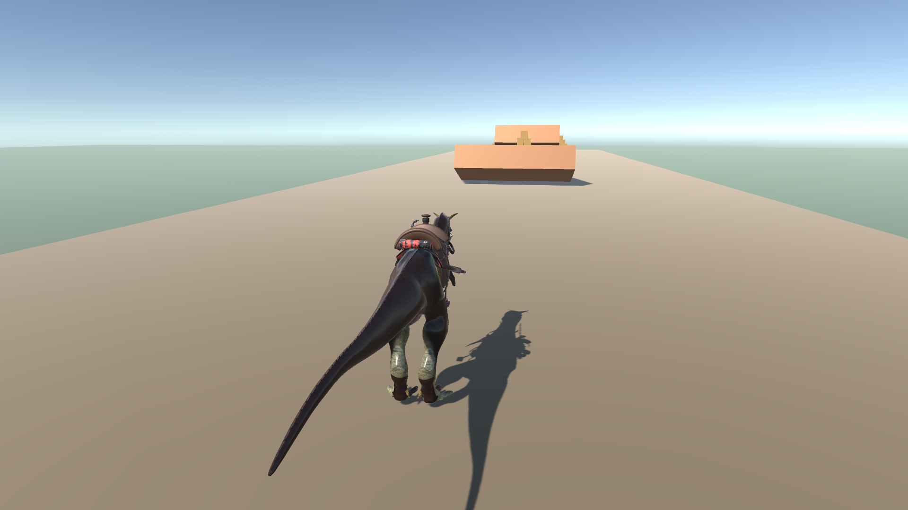
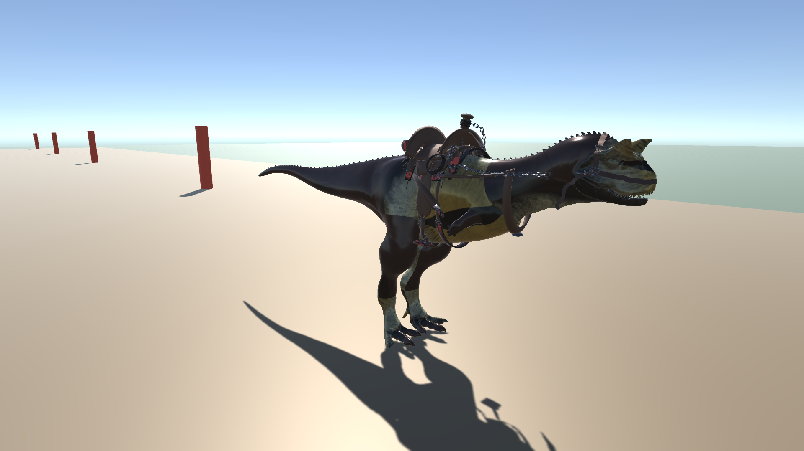

# Carnotaurus Rider (Realidad Mixta & Computación Física)

Simulador y videojuego de conducción en Unity 6 donde el vehículo es un **Carnotauro de DinoWest** equipado con montura, silla de montar y riendas, controlado mediante hardware físico basado en **Arduino** o teclado para pruebas.

---

## 👥 Equipo de Desarrollo (Universidad de Boyacá)

| Integrante | Correo Institucional | Rol Principal |
| :--- | :--- | :--- |
| **Juan J. Plazas** | `jjplazas@uniboyaca.edu.co` | *Lead Gameplay & Vehicle Physics Architecture* |
| **K. J. Barreto** | `Kjbarreto@uniboyaca.edu.co` | *Physical Computing & Arduino Hardware Integration* |
| **David Rosas** | `davrosas@uniboyaca.edu.co` | *3D Art, PBR Materials & Level Design* |

---

## 📸 Capturas del Proyecto

| Vista de Conducción (Pista de Pruebas) | Detalle del Carnotauro con Montura |
| :---: | :---: |
|  |  |

---

## ⚙️ Características Principales

1. **Física Vehicular de Criatura:**
   - Control de masa e inercia animal (1200 kg) con `Rigidbody`.
   - Sistema de tracción terrestre con alineación a pendientes del terreno.
   - Balanceo visual del cuerpo (*banking*) en giros a alta velocidad.
   - Pisotón y salto físico con detección de suelo (`SphereCast`).
   - Demolición física de obstáculos (pirámides de cajas destructibles con rebote dinámico).

2. **Modelo 3D y Gráficos (DinoWest):**
   - **Carnotauro DW** con montura completa: silla de cuero, peto, estribos, funda de rifle, cabezada y cadenas de riendas articuladas.
   - Texturizado PBR: mapas de difusión en alta resolución, normales de escamas y reflejo de ojos.
   - Animaciones integradas: `Idle`, `Walk`, `Run`, `Roar` y `Attack_HornRam`.

3. **Arquitectura de Entrada Dual (Doble Fuente):**
   - **Modo Teclado (Simulación):** Permite probar y calibrar sin hardware conectado.
   - **Modo Arduino Serial (Hardware Físico):** Comunicación USB de baja latencia (115200 baudios) en hilo de ejecución secundario (`Thread`), evitando caídas de frames en Unity.

4. **Cámara Dinámica y HUD:**
   - Cámara de seguimiento en tercera persona con interpolación suave (`DinoFollowCamera`).
   - Campo de visión dinámico (FOV) que se expande a alta velocidad o durante el turbo.
   - Sacudida de cámara (*Screen Shake*) en saltos, impactos y rugidos.
   - HUD en pantalla con velocímetro en km/h, estado del dinosaurio y monitor de conexión de Arduino.

---

## 🎮 Controles de Prueba (Teclado)

| Tecla | Acción | Comportamiento |
| :--- | :--- | :--- |
| `W` / `S` | Acelerador / Reversa | Control proporcional de velocidad con zancadas dinámicas. |
| `A` / `D` | Dirección (Volante) | Giro con arco vehicular e inclinación lateral del cuerpo. |
| `Espacio` | Freno | Detiene la inercia con fuerza de fricción. |
| `F` | Salto / Pisotón | Impulso vertical y sacudida de cámara al caer. |
| `E` o `Click Izq` | Rugido Bestia (Turbo) | Emite rugido real, sacude la cámara y activa turbo (1.6x) por 3.5 segundos. |
| `Left Shift` | Sprint continuo | Aceleración sostenida. |
| `R` | Reiniciar posición | Reubica el carnotauro en la pista si vuelca. |

---

## 🔌 Conexión de Hardware (Arduino)

El sketch listo para cargar en la placa se encuentra en:
`Assets/Dino/ArduinoSketch/DinoController.ino`

### Pinout recomendado:
* **Pin A0:** Potenciómetro de Dirección (Volante / Manillar)
* **Pin A1:** Potenciómetro de Velocidad (Palanca / Pedal)
* **Pin 2:** Pulsador tipo Arcade para Salto / Pisotón (`INPUT_PULLUP`)
* **Pin 3:** Pulsador / Switch para Rugido / Turbo (`INPUT_PULLUP`)
* **Baudrate:** 115200 baudios

---

## 📁 Estructura del Proyecto

```
Assets/
├── Dino/
│   ├── ArduinoSketch/
│   │   └── DinoController.ino       # Código C++ para Arduino (Kjbarreto)
│   ├── Audio/
│   │   └── Rugido.wav               # Sonido de rugido de alta calidad
│   ├── Editor/
│   │   ├── BuildTestTrackScene.cs   # Generador de escena y build ejecutable
│   │   ├── DWSetup.cs               # Configuración de importador FBX y materiales
│   │   └── TakeScreenshot.cs        # Utilidad de captura de pantalla
│   ├── Materials/
│   │   ├── M_DW_Carnotauro_Piel.mat
│   │   ├── M_DW_Carnotauro_Ojos.mat
│   │   ├── M_DW_Silla_Cuero.mat
│   │   └── M_DW_Hierro_Cadenas.mat
│   ├── Model/
│   │   ├── DW_Carnotauro_UE5.fbx    # Modelo 3D con montura y rig
│   │   └── DW_Carnotaurus_Vehicle.controller
│   ├── Scenes/
│   │   └── DinoTestTrack.unity      # Pista de pruebas con rampas y obstáculos
│   ├── Scripts/
│   │   ├── ArduinoSerialConnector.cs# Comunicación Serial multihilo (Kjbarreto)
│   │   ├── DinoAnimationDriver.cs   # Sincronización de animaciones con física (davrosas)
│   │   ├── DinoFollowCamera.cs      # Cámara dinámica en 3ra persona con shake (jjplazas)
│   │   ├── DinoHUD.cs               # Interfaz gráfica y velocímetro (jjplazas)
│   │   ├── DinoInputManager.cs      # Abstracción de entradas Teclado / Arduino (jjplazas)
│   │   └── DinoVehicleController.cs # Controlador vehicular con Rigidbody (jjplazas)
│   └── Textures/
│       ├── DW_Carnotauro_Piel_NegroRojo.png
│       ├── DW_Carnotauro_Normales.png
│       └── DW_Carnotauro_Ojos.png
└── Plugins/
    └── System.IO.Ports.dll          # Soporte de puerto Serial para Unity (Kjbarreto)
```
